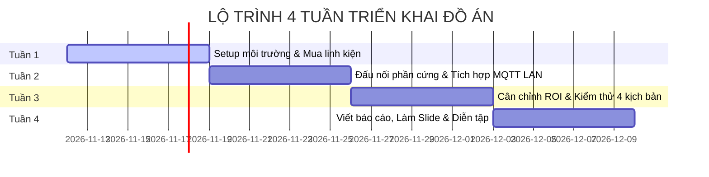

# BẢNG KẾ HOẠCH TIẾN ĐỘ & DEADLINE 4 TUẦN ĐỒ ÁN CUỐI KỲ

**Đề tài:** Hệ thống IoT giám sát và phát hiện xâm nhập trước cửa nhà dựa trên phân tích hành vi bất thường  
**Mô hình làm việc:** Nhóm 3 thành viên  
**Phương pháp quản lý:** Agile/Scrum theo tuần (Sprint 1 tuần)

---

---

## 📅 TUẦN 1: KHỞI ĐỘNG, MUA SẮM LINH KIỆN & KIỂM THỬ ĐƠN LẺ (UNIT SETUP)
> **Mục tiêu tuần (Sprint Goal):** Chuẩn bị đầy đủ linh kiện phần cứng, thiết lập môi trường phần mềm trên máy tính, chạy thử nghiệm độc lập từng phân hệ (ESP32, AI Backend, Web Frontend) thành công.

### 📌 Phân công nhiệm vụ chi tiết:
- [ ] **Thành viên 1 (Hardware & Firmware):**
  - Mua sắm đầy đủ linh kiện: ESP32 DevKit V1 (38 chân), cảm biến cửa từ MC-38, PIR HC-SR501, OLED 0.96" I2C, còi Active Buzzer 5V, Relay 5V, 2 LED (Xanh/Đỏ) + điện trở 220Ω, nút nhấn, dây cắm breadboard.
  - Cài đặt Arduino IDE và các thư viện cần thiết (`PubSubClient`, `Adafruit SSD1306`, `Adafruit GFX`).
  - Nạp thử code nhấp nháy LED và test độc lập cảm biến cửa từ MC-38 xem Serial Monitor có đọc được trạng thái `0` (đóng) và `1` (mở).
- [ ] **Thành viên 2 (Edge AI & Backend):**
  - Cài đặt môi trường Python 3.10+ và tạo môi trường ảo `venv`.
  - Cài đặt toàn bộ thư viện qua `pip install -r requirements.txt`.
  - Cắm USB Webcam vào máy, chạy thử file `camera_stream.py` để đảm bảo nhận diện webcam DirectShow không bị delay.
  - Tải trọng số mô hình `yolov8n.pt`, chạy thử nghiệm nhận diện người trên máy tính.
- [ ] **Thành viên 3 (Dashboard & MQTT Lead):**
  - Cài đặt Mosquitto MQTT Broker trên máy tính, khởi động dịch vụ và kiểm tra cổng `1883`.
  - Chạy `npm install` và `npm run dev` trong thư mục `dashboard/`.
  - Kiểm tra giao diện Dashboard trên trình duyệt (`http://localhost:5173`).
  - Lập khung sườn mục lục Báo cáo đồ án (File Word/LaTeX).

### 🎯 Sản phẩm bàn giao cuối Tuần 1:
1. Đầy đủ linh kiện phần cứng đã được test thông mạch.
2. Backend FastAPI và Web Dashboard khởi động thành công trên máy tính cục bộ.
3. ESP32 nạp được code mẫu không báo lỗi biên dịch.

---

## 📅 TUẦN 2: ĐẤU NỐI PHẦN CỨNG & GHÉP NỐI MẠNG LAN / MQTT
> **Mục tiêu tuần (Sprint Goal):** Lắp ráp toàn bộ mạch điện tử hoàn chỉnh theo sơ đồ pinout; kết nối ESP32 và Server vào cùng mạng WiFi nội bộ; đảm bảo thông suốt dữ liệu hai chiều qua MQTT.

### 📌 Phân công nhiệm vụ chi tiết:
- [ ] **Thành viên 1 (Hardware & Firmware):**
  - Nối toàn bộ chân linh kiện vào ESP32 theo bảng pinout chuẩn:
    * MC-38: GPIO 14 (Interrupt `CHANGE`)
    * PIR: GPIO 13 | Buzzer: GPIO 27 | Relay: GPIO 26 | Button: GPIO 15
    * OLED: SDA (GPIO 21), SCL (GPIO 22) | LED Xanh: GPIO 4, LED Đỏ: GPIO 2
  - Cập nhật thông số mạng WiFi (`WIFI_SSID`, `WIFI_PASSWORD`) và địa chỉ IP của máy chủ chạy MQTT (`MQTT_SERVER`) vào `esp32_security_node.ino`.
  - Nạp firmware hoàn chỉnh vào ESP32.
  - Kiểm tra màn hình OLED: Phải hiển thị đúng địa chỉ IP WiFi nội bộ và trạng thái MQTT `ONLINE`.
- [ ] **Thành viên 2 (Edge AI & Backend):**
  - Tạo Telegram Bot qua `@BotFather`, lấy Token và Chat ID của nhóm.
  - Cấu hình file `backend/.env` và test gửi tin nhắn/ảnh cảnh báo về điện thoại thành công.
  - Ghép nối `loitering_engine.py` với `mqtt_client.py`: Khi lảng vảng > 20s, backend phải tự động publish payload `{"alarm":"ON"}` lên topic `home/actuator/alarm`.
- [ ] **Thành viên 3 (Dashboard & MQTT Lead):**
  - Cấu hình Firewall Windows mở cổng `1883` (Inbound Rules) để ESP32 có thể gửi gói tin vào máy chủ.
  - Dùng công cụ **MQTT Explorer** (hoặc CLI) bắt gói tin từ ESP32 gửi lên:
    * Kiểm tra topic `home/sensor/door` đổi `"OPEN"` / `"CLOSED"` khi tách nam châm.
    * Kiểm tra topic `home/sensor/pir` đổi `"MOTION"` / `"STILL"` khi quơ tay trước cảm biến.
  - Xác nhận Dashboard hiển thị đúng các badge trạng thái thời gian thực.

### 🎯 Sản phẩm bàn giao cuối Tuần 2:
1. Mạch phần cứng ESP32 hoạt động đầy đủ tính năng: tách cửa còi kêu ngay, OLED cập nhật trạng thái.
2. Dữ liệu cảm biến đẩy lên MQTT mượt mà và hiển thị trực tiếp lên Web Dashboard.
3. Bot Telegram gửi được ảnh snapshot cảnh báo về điện thoại.

---

## 📅 TUẦN 3: KIỂM THỬ KỊCH BẢN AN NINH THỰC TẾ & LÀM MÔ HÌNH CỬA
> **Mục tiêu tuần (Sprint Goal):** Dựng mô hình cửa vật lý hoàn chỉnh; cân chỉnh góc camera và vùng đa giác ROI; chạy thử nghiệm 4 kịch bản an ninh thực tế (End-to-End Testing).

### 📌 Phân công nhiệm vụ chi tiết:
- [ ] **Thành viên 1 (Hardware & Firmware):**
  - Dựng sa bàn/mô hình cánh cửa mini (bằng mica, fomex hoặc gỗ nhỏ có bản lề đóng/mở được).
  - Gắn cảm biến từ MC-38 lên khung và cánh cửa (đảm bảo khi đóng thì 2 má nam châm chạm nhau, khi mở thì tách ra).
  - Cố định bo mạch ESP32, màn hình OLED, còi hú và cảm biến PIR gọn gàng vào hộp bảo vệ.
- [ ] **Thành viên 2 (Edge AI & Backend):**
  - Đặt webcam chiếu thẳng vào mô hình cửa.
  - Dùng tính năng mới **"Cân chỉnh ROI"** trên Dashboard để click 4 điểm tạo đa giác bao phủ chính xác khu vực trước cửa.
  - Tinh chỉnh ngưỡng thời gian lảng vảng (20s) và bộ đệm chống spam cảnh báo (Cooldown 30s) cho tối ưu.
  - Thu thập các chỉ số kỹ thuật: FPS trung bình của hệ thống, thời gian phản hồi từ lúc lảng vảng đến lúc còi hú và Telegram nhận ảnh.
- [ ] **Thành viên 3 (Dashboard & MQTT Lead):**
  - Chủ trì chạy kiểm thử đầy đủ 4 kịch bản theo tài liệu `TESTING_AND_DEMO_GUIDE.md`:
    * *Kịch bản 1:* Người đứng trước cửa > 20s (Loitering Alarm).
    * *Kịch bản 2:* Cạy/mở cửa khi đang ARMED (Hardware Interrupt Door Breach).
    * *Kịch bản 3:* Nhấn nút Panic khẩn cấp tại chỗ (GPIO 15).
    * *Kịch bản 4:* Điều khiển tắt còi (Mute) và Bật/Tắt bảo vệ (Arm/Disarm) từ Dashboard.
  - Ghi nhận lỗi phát sinh (nếu có) để 2 thành viên còn lại fix ngay.
  - Chụp lại toàn bộ ảnh chụp màn hình giao diện Dashboard và ảnh chụp thực tế mô hình để chuẩn bị đưa vào báo cáo.

### 🎯 Sản phẩm bàn giao cuối Tuần 3:
1. Mô hình cánh cửa demo thực tế có gắn mạch hoàn chỉnh, chắc chắn và thẩm mỹ.
2. Hệ thống vượt qua 100% các kịch bản kiểm thử không phát sinh lỗi nghẽn hay mất kết nối.
3. Bảng số liệu đo đạc thực nghiệm (FPS, độ trễ mạng LAN, thời gian gửi Telegram).

---

## 📅 TUẦN 4: VIẾT BÁO CÁO, THIẾT KẾ SLIDE & DIỄN TẬP BẢO VỆ
> **Mục tiêu tuần (Sprint Goal):** Hoàn thiện 100% cuốn Thuyết minh Báo cáo Đồ án, Slide thuyết trình PowerPoint chuyên nghiệp, quay video demo dự phòng và diễn tập trả lời phản biện.

### 📌 Phân công nhiệm vụ chi tiết:
- [ ] **Thành viên 1 (Hardware & Firmware):**
  - Viết phần cứng trong báo cáo: Bảng thông số linh kiện, sơ đồ chân pinout nối dây, nguyên lý ngắt phần cứng MC-38 và cơ chế Non-blocking timer trên ESP32.
  - Ôn luyện bộ câu hỏi vấn đáp Phần 1 trong file `DEFENSE_QA_GUIDE.md`.
  - Vệ sinh, kiểm tra lại dây nối, nguồn cấp cho mô hình cửa demo trước ngày bảo vệ.
- [ ] **Thành viên 2 (Edge AI & Backend):**
  - Viết phần AI & Backend trong báo cáo: Giải thích thuật toán YOLOv8n + ByteTrack, công thức kiểm tra điểm nằm trong đa giác ROI (`pointPolygonTest`), kiến trúc khử trễ video webcam DirectShow.
  - Vẽ biểu đồ luồng thuật toán phát hiện hành vi lảng vảng.
  - Ôn luyện bộ câu hỏi vấn đáp Phần 2 trong file `DEFENSE_QA_GUIDE.md`.
- [ ] **Thành viên 3 (Dashboard & MQTT Lead):**
  - Viết phần Hệ thống & Dashboard trong báo cáo: Sơ đồ kiến trúc Hybrid Edge-IoT, bảng phân tích giao thức MQTT (Topics & QoS 1), cơ sở dữ liệu SQLite, giao diện Web React 18.
  - Tổng hợp, định dạng format chuẩn cuốn báo cáo (Mục lục, tài liệu tham khảo, số trang, bìa).
  - Thiết kế bộ **Slide thuyết trình PowerPoint / Canva** (khoảng 15 - 20 slide, nhiều hình ảnh và biểu đồ trực quan, ít chữ).
  - Quay một đoạn **Video Clip Demo hoàn chỉnh (2 - 3 phút)** quay lại quá trình hoạt động của mô hình để dự phòng khi đi bảo vệ nếu mạng trường gặp sự cố.
  - Ôn luyện bộ câu hỏi vấn đáp Phần 3 trong file `DEFENSE_QA_GUIDE.md`.

### 🎯 Sản phẩm bàn giao cuối Tuần 4 (Hoàn tất đồ án):
1. 📕 **File Báo cáo Đồ án hoàn chỉnh (PDF/Word)** đầy đủ nội dung từ mở đầu đến kết luận.
2. 💻 **Slide Thuyết trình PowerPoint** đẹp mắt, chuyên nghiệp.
3. 🎥 **Video Demo thực tế** rõ nét quay cảnh mô hình cửa và Dashboard.
4. 🚪 **Mô hình phần cứng sẵn sàng** vận hành trơn tru trước Hội đồng chấm điểm.

---

## 📊 BẢNG TỔNG HỢP THEO DÕI TIẾN ĐỘ TUẦN (SPRINT TRACKER)

| Tuần | Trọng tâm công việc | Người phụ trách chính | Tình trạng | Kết quả đánh giá |
| :---: | :--- | :--- | :---: | :---: |
| **Tuần 1** | Chuẩn bị linh kiện & Chạy thử môi trường đơn lẻ | Cả 3 thành viên | ⏳ Chưa bắt đầu | Đạt / Chưa đạt |
| **Tuần 2** | Lắp mạch phần cứng & Ghép nối dữ liệu MQTT LAN | TV1 (Mạch) - TV2 (AI/Tele) - TV3 (Broker) | ⏳ Chưa bắt đầu | Đạt / Chưa đạt |
| **Tuần 3** | Cân chỉnh ranh giới ROI & Test 4 kịch bản thực tế | TV2 (AI/ROI) - TV1 (Làm cửa) - TV3 (Test E2E) | ⏳ Chưa bắt đầu | Đạt / Chưa đạt |
| **Tuần 4** | Hoàn thiện Báo cáo, Slide, Video Demo & Diễn tập | TV3 (Chủ trì Báo cáo/Slide) - TV1 & TV2 (Dữ liệu) | ⏳ Chưa bắt đầu | Đạt / Chưa đạt |

---

> 💡 **Mẹo làm việc nhóm hiệu quả:**
> - Cả nhóm nên họp ngắn 15 phút vào **Chủ Nhật hàng tuần** để rà soát các checkbox trong file này.
> - Bất kỳ khi nào gặp bug không tự giải quyết được trong 2 tiếng, hãy tag các bạn còn lại để cùng tháo gỡ, không giấu lỗi để trễ tiến độ tuần.
