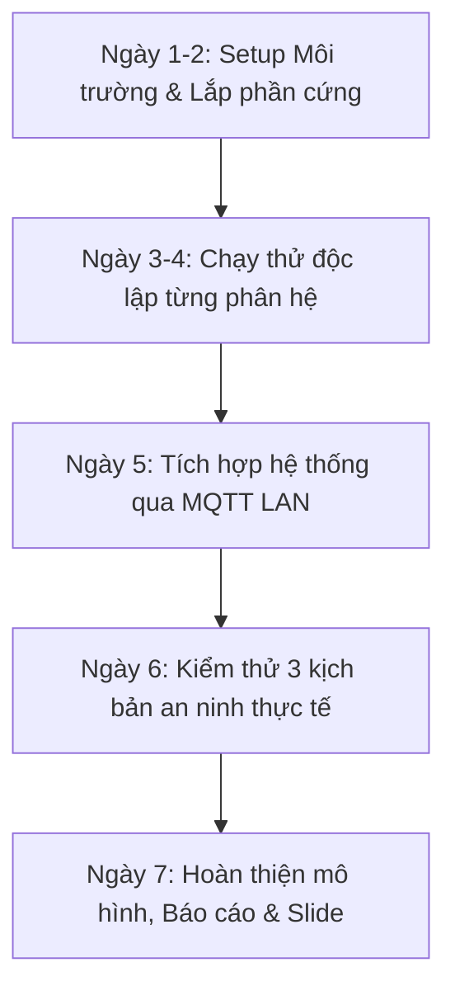

# KẾ HOẠCH PHÂN CHIA NHIỆM VỤ ĐỒ ÁN CUỐI KỲ (NHÓM 3 THÀNH VIÊN)
**Đề tài:** Hệ thống IoT giám sát và phát hiện xâm nhập trước cửa nhà dựa trên phân tích hành vi bất thường  
**Kiến trúc:** Hybrid Edge-IoT (Laptop Edge AI Server + ESP32 Peripheral Node)

---

## I. TỔNG QUAN HIỆN TRẠNG MÃ NGUỒN (AI ASSISTANT ĐÃ XÂY DỰNG SẴN)

AI Assistant đã triển khai sẵn **100% mã nguồn cốt lõi** trong repository. Nhóm không phải viết lại từ đầu mà tập trung vào **lắp ráp phần cứng thật, cấu hình tham số, kiểm thử kịch bản, làm mô hình và viết báo cáo/slide**:

| Phân hệ | Mã nguồn AI đã tạo sẵn | Trạng thái hiện tại |
| :--- | :--- | :--- |
| **Firmware ESP32** | `firmware/esp32_security_node/esp32_security_node.ino` | Đã xong logic Non-blocking, ngắt MC-38, OLED, MQTT pub/sub, Buzzer/Relay. |
| **Backend & AI** | `backend/app/services/loitering_engine.py` `backend/app/services/camera_stream.py` `backend/app/mqtt_client.py` `backend/app/telegram_notifier.py` | Đã xong YOLOv8n + ByteTrack, tính dwell time > 20s trong ROI, lưu SQLite, gửi Telegram và MQTT. |
| **Web Dashboard** | `dashboard/src/components/*` `dashboard/src/App.jsx` | Đã xong giao diện giám sát, live stream MJPEG, điều khiển nhanh, bảng incident logs có ảnh bằng chứng. |
| **Automation Script** | `start_all.bat` | Đã xong script 1-click chạy Mosquitto, Backend và Dashboard trên Windows. |

---

## II. BẢNG PHÂN CHIA TRÁCH NHIỆM CHO 3 THÀNH VIÊN

### THÀNH VIÊN 1: Kỹ sư Phần Cứng & Firmware (IoT Hardware & Embedded Engineer)
> **Trách nhiệm chính:** Toàn bộ phần cứng ESP32, linh kiện ngoại vi, nạp firmware, thiết kế mô hình/hộp bảo vệ cửa và kiểm thử tại chỗ.

- **Đóng góp từ mã nguồn có sẵn:**
  - File firmware: `firmware/esp32_security_node/esp32_security_node.ino`.
- **Nhiệm vụ cụ thể cần thực hiện:**
  1. **Đấu nối dây phần cứng:**
     - Hàn/nối dây Breadboard hoặc làm mạch test theo bảng chân pinout: MC-38 (GPIO 14), PIR (GPIO 13), OLED (GPIO 21/22), Buzzer (GPIO 27), Relay (GPIO 26), Nút Emergency (GPIO 15), LEDs (GPIO 4, GPIO 2).
  2. **Cấu hình & Nạp Firmware:**
     - Cài Arduino IDE, nạp các thư viện `PubSubClient`, `Adafruit SSD1306`, `Adafruit GFX`.
     - Đổi thông tin `WIFI_SSID`, `WIFI_PASSWORD` và địa chỉ `MQTT_SERVER` sang IP của Laptop Thành viên 2 hoặc 3.
  3. **Kiểm tra hoạt động phần cứng tại chỗ:**
     - Test ngắt cửa từ MC-38: tách nam châm xem có phát hiện tức thì và còi hú không.
     - Cân chỉnh độ nhạy (chiết áp) và thời gian trễ của cảm biến PIR HC-SR501.
     - Kiểm tra màn hình OLED có hiển thị đúng IP, chế độ ARMED/DISARMED và đếm số lần báo động.
  4. **Làm mô hình cửa demo:**
     - Dựng sa bàn/mô hình cánh cửa (bằng bìa fomex, mica hoặc gỗ nhỏ) gắn cảm biến MC-38 và PIR để mang đi thuyết trình trực quan trước hội đồng chấm.

---

### THÀNH VIÊN 2: Kỹ sư Edge AI & Xử Lý Ảnh (Computer Vision & Backend Engineer)
> **Trách nhiệm chính:** Vận hành luồng Camera USB Webcam, tối ưu hoá thuật toán YOLOv8 + ByteTrack, cân chỉnh vùng ROI cửa, tích hợp Telegram Bot cảnh báo và quản lý Backend FastAPI.

- **Đóng góp từ mã nguồn có sẵn:**
  - Toàn bộ thư mục `backend/` (FastAPI, OpenCV, YOLOv8 loitering engine, SQLite database, Telegram service).
- **Nhiệm vụ cụ thể cần thực hiện:**
  1. **Thiết lập môi trường Backend:**
     - Chạy môi trường ảo Python (`venv`), cài `requirements.txt`.
     - Tải và đặt trọng số mô hình `yolov8n.pt` vào backend.
     - Kiểm tra khả năng nhận diện của Webcam USB cắm vào laptop (`cv2.VideoCapture(0)`).
  2. **Cân chỉnh vùng ROI thực tế:**
     - Đặt camera chiếu thẳng vào mô hình cửa.
     - Điều chỉnh toạ độ đa giác `DEFAULT_ROI_PERCENT` trong `backend/app/config.py` khớp chính xác với khu vực đứng trước cửa nhà để nhận diện người bước vào/ra.
  3. **Cấu hình Telegram Bot:**
     - Tạo Bot Telegram qua `@BotFather`, lấy `TELEGRAM_BOT_TOKEN`.
     - Lấy `TELEGRAM_CHAT_ID` của nhóm, điền vào file `backend/.env` và bật `TELEGRAM_ENABLED=true`.
     - Test nhận ảnh chụp bằng chứng (snapshot) gửi về điện thoại khi có người lảng vảng > 20 giây.
  4. **Đo đạc số liệu kỹ thuật cho báo cáo:**
     - Đo FPS trung bình của hệ thống khi chạy YOLOv8n trên CPU/GPU của máy tính.
     - Đo độ trễ từ lúc phát hiện lảng vảng đến khi Telegram nhận được ảnh và còi ESP32 hú.

---

### THÀNH VIÊN 3: Kỹ sư Hệ Thống, Dashboard & Tích Hợp (Fullstack, MQTT & QA/PM)
> **Trách nhiệm chính:** Triển khai Mosquitto MQTT Broker, chạy Web Dashboard React, kiểm thử kịch bản End-to-End, làm slide thuyết trình và tổng hợp báo cáo đồ án.

- **Đóng góp từ mã nguồn có sẵn:**
  - Toàn bộ thư mục `dashboard/` (React 18, Vite, TailwindCSS) và file `start_all.bat`.
- **Nhiệm vụ cụ thể cần thực hiện:**
  1. **Cấu hình Hạ tầng & MQTT Broker:**
     - Cài đặt Mosquitto trên máy tính đóng vai trò Edge Server (hoặc cấu hình firewall Windows để mở cổng `1883` cho ESP32 kết nối vào qua mạng LAN/WiFi).
     - Kiểm tra kết nối MQTT hai chiều giữa ESP32 và Backend thông qua công cụ MQTT Explorer hoặc CLI.
  2. **Vận hành Frontend Dashboard:**
     - Chạy `npm install` và `npm run dev` trên thư mục `dashboard`.
     - Kiểm tra hiển thị Live video stream, cập nhật thời gian thực badge cảm biến (Cửa Mở/Đóng, PIR), các nút bấm (Arm/Disarm, Mute còi) và bảng lịch sử sự cố.
  3. **Kiểm thử liên hợp (End-to-End Integration Testing):**
     - Đứng ra làm "nhạc trưởng" test 3 kịch bản chính:
       * *Kịch bản 1:* Hệ thống ARMED -> Mở cửa MC-38 -> Còi hú ngay, Dashboard đổi trạng thái đỏ, ghi log.
       * *Kịch bản 2:* Hệ thống ARMED -> Người đứng trước cửa > 20s -> Camera vẽ viền đỏ, còi hú, gửi ảnh Telegram, xuất hiện trên Incident Logs.
       * *Kịch bản 3:* Bấm nút "Mute Alarm" hoặc "Disarm" trên Dashboard -> Còi ESP32 tắt ngay lập tức.
  4. **Soạn thảo Báo cáo & Slide thuyết trình:**
     - Soạn thảo tài liệu báo cáo đồ án (Word/LaTeX): Viết chương Cơ sở lý thuyết (IoT, MQTT, YOLOv8), Sơ đồ kiến trúc khối, Sơ đồ kết nối phần cứng và Kết quả thực nghiệm.
     - Thiết kế Slide thuyết trình PowerPoint / Canva và chuẩn bị video demo dự phòng.

---

## III. LỘ TRÌNH KHỞI ĐỘNG DỰ ÁN TRONG 7 NGÀY

- **Ngày 1 - 2 (Chuẩn bị):**
  - Thành viên 1 mua đủ linh kiện và nối dây theo bảng pinout trong `README.md`.
  - Thành viên 2 clone repo, chạy `pip install -r requirements.txt`, tạo bot Telegram.
  - Thành viên 3 cài Mosquitto broker, chạy thử Dashboard với lệnh `npm run dev`.
- **Ngày 3 - 4 (Thử nghiệm đơn lẻ):**
  - Thành viên 1 nạp code ESP32, test cảm biến cửa MC-38 với Serial Monitor.
  - Thành viên 2 test webcam và thuật toán loitering engine với người thật trước camera.
- **Ngày 5 (Ghép nối mạng LAN):**
  - Kết nối Laptop và ESP32 vào cùng 1 mạng WiFi (hoặc phát 4G từ điện thoại).
  - Khởi chạy toàn bộ hệ thống bằng file `start_all.bat`.
- **Ngày 6 (Kiểm thử kịch bản):**
  - Chạy thử liên tục 3 kịch bản: Mở cửa đột nhập, Lảng vảng quá 20s, Điều khiển tắt báo động từ xa.
- **Ngày 7 (Đóng gói hoàn tất):**
  - Gắn mạch lên mô hình cửa hoàn thiện.
  - Tổng hợp số liệu FPS, độ trễ và hình ảnh thực tế vào Báo cáo & Slide.

