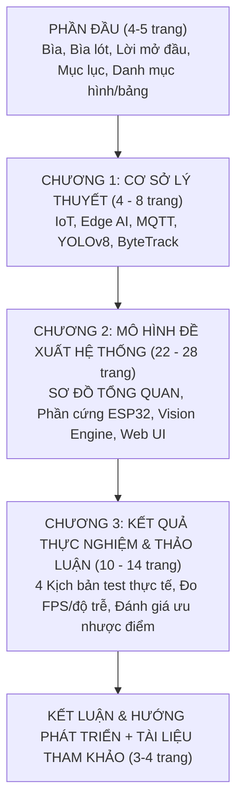
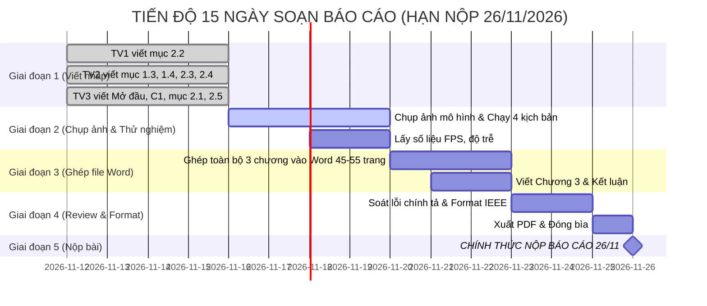

# KẾ HOẠCH CHI TIẾT VIẾT BÁO CÁO ĐỒ ÁN TỐT NGHIỆP / CUỐI KỲ
**Đề tài:** Hệ thống IoT giám sát và phát hiện xâm nhập trước cửa nhà dựa trên phân tích hành vi bất thường  
**Hạn nộp chính thức:** **26/11/2026** (15 ngày)  
**Quy cách bắt buộc:** File Word | Dung lượng: **40 - 60 trang** | Cấu trúc chuẩn: **3 CHƯƠNG**

---

## I. CẤU TRÚC BÁO CÁO CHUẨN 3 CHƯƠNG (40 - 60 TRANG)

---

## II. BẢNG PHÂN BỔ TRANG & PHÂN CÔNG 3 THÀNH VIÊN

| Mục / Chương | Nội dung chi tiết | Số trang | Phụ trách chính |
| :--- | :--- | :---: | :---: |
| **PHẦN ĐẦU** | - Trang bìa chính (Bìa cứng/màu) - Trang bìa lót - Lời cam đoan & Lời cảm ơn - Lời mở đầu (Lý do chọn đề tài, tính cấp thiết) - Mục lục tự động, Danh mục từ viết tắt, Danh mục hình/bảng | **4 - 5 trang** | **Thành viên 3** |
| **CHƯƠNG 1** | **CƠ SỞ LÝ THUYẾT** (Giới hạn chuẩn: 4 - 8 trang) - 1.1. Tổng quan công nghệ IoT và Điện toán biên (Edge Computing) - 1.2. Giao thức truyền thông MQTT và cơ chế QoS/Retain - 1.3. Tổng quan mạng nơ-ron tích chập và mô hình YOLOv8 - 1.4. Thuật toán theo dõi đối tượng ByteTrack | **6 - 8 trang** | **TV3** (1.1, 1.2) **TV2** (1.3, 1.4) |
| **CHƯƠNG 2** | **MÔ HÌNH ĐỀ XUẤT: HỆ THỐNG IOT GIÁM SÁT VÀ PHÁT HIỆN XÂM NHẬP TRƯỚC CỬA NHÀ DỰA TRÊN PHÂN TÍCH HÀNH VI BẤT THƯỜNG** - **2.1. SƠ ĐỒ TỔNG QUAN HỆ THỐNG (System Architecture Diagram)** - 2.2. Thiết kế phân hệ Phần cứng & Vi điều khiển ESP32 - 2.3. Thiết kế phân hệ Thị giác máy tính & Edge AI Engine - 2.4. Thiết kế phân hệ Backend FastAPI & Giao tiếp MQTT - 2.5. Thiết kế Giao diện Giám sát Web Dashboard React 18 | **24 - 28 trang** | **TV1** (Mục 2.2) **TV2** (Mục 2.3, 2.4) **TV3** (Mục 2.1, 2.5) |
| **CHƯƠNG 3** | **KẾT QUẢ THỰC NGHIỆM VÀ THẢO LUẬN** - 3.1. Môi trường thử nghiệm & Mô hình cửa vật lý - 3.2. Kết quả thực nghiệm 4 kịch bản an ninh thực tế - 3.3. Đo đạc các chỉ số kỹ thuật (FPS, thời gian đáp ứng, độ trễ) - 3.4. Thảo luận, so sánh với hệ thống truyền thống & Phân tích lỗi | **10 - 14 trang** | **Cả 3 thành viên** (TV1: Mạch/Cửa TV2: AI/FPS TV3: Tổng hợp/Test) |
| **PHẦN CUỐI** | - KẾT LUẬN VÀ HƯỚNG PHÁT TRIỂN (2 trang) - TÀI LIỆU THAM KHẢO (Chuẩn IEEE, tối thiểu 8-12 nguồn) - PHỤ LỤC: Mã nguồn cốt lõi (Arduino .ino, Python, React) | **4 - 6 trang** | **Thành viên 3** chủ trì TV1 & TV2 góp code |
| **TỔNG CỘNG** | **Toàn bộ quyển báo cáo Word** | **48 - 60 trang** | **ĐẠT CHUẨN** |

---

## III. CHI TIẾT NỘI DUNG TỪNG PHẦN ĐỂ VIẾT NGAY

### 1. PHẦN ĐẦU (4 - 5 trang - TV3 phụ trách)
- **Trang bìa & Bìa lót:** Tên Trường/Khoa/Bộ môn, Tên đề tài in hoa đậm, GVHD, Hội đồng chấm, Danh sách 3 sinh viên thực hiện (Họ tên, MSSV, Lớp), Tháng 11/2026.
- **Lời mở đầu:** Nêu bối cảnh an ninh cửa nhà, tỷ lệ trộm cắp và điểm yếu của camera thụ động truyền thống. Đặt mục tiêu chế tạo hệ thống cảnh báo chủ động trước khi cửa bị cạy.
- **Mục lục, Danh mục hình vẽ, Danh mục bảng biểu:** Định dạng tự động bằng tính năng *Table of Contents* của Word.

---

### 2. CHƯƠNG 1: CƠ SỞ LÝ THUYẾT (6 - 8 trang)
*(Bám sát yêu cầu từ 4 đến 8 trang, tập trung cô đọng các khái niệm nền tảng)*
- **1.1. Công nghệ IoT và Mô hình Hybrid Edge Computing (1.5 trang - TV3):**
  - Khái niệm mạng vạn vật IoT trong Smart Home.
  - Phân tích sự chuyển dịch từ Cloud AI sang Edge AI: Khử độ trễ đường truyền, bảo vệ tính riêng tư hình ảnh gia đình, đảm bảo khả năng sống sót khi mất mạng Internet.
- **1.2. Giao thức truyền thông nhẹ MQTT (1.5 trang - TV3):**
  - Cơ chế Client/Server và Pub/Sub qua Broker trung tâm.
  - Cấu trúc cây Topic, ý nghĩa các cấp độ dịch vụ QoS (tập trung phân tích QoS 1) và cơ chế Retained Messages.
- **1.3. Mô hình thị giác máy tính YOLOv8 (2 trang - TV2):**
  - Cấu trúc mạng phát hiện đối tượng thời gian thực YOLOv8 (Backbone, PAN-FPN Neck, Anchor-free Head).
  - So sánh các phiên bản (n, s, m, l, x) & lý do chọn phiên bản Nano (YOLOv8n) cho bài toán Edge AI.
- **1.4. Thuật toán theo dõi đối tượng ByteTrack (1.5 trang - TV2):**
  - Nguyên lý gán Track ID liên tục dựa trên bộ lọc Kalman Filter và thuật toán Hungarian Matching, ưu điểm giữ dấu đối tượng khi bị che khuất một phần.

---

### 3. CHƯƠNG 2: MÔ HÌNH ĐỀ XUẤT HỆ THỐNG IOT GIÁM SÁT VÀ PHÁT HIỆN XÂM NHẬP TRƯỚC CỬA NHÀ DỰA TRÊN PHÂN TÍCH HÀNH VI BẤT THƯỜNG (24 - 28 trang - CHƯƠNG TRỌNG TÂM)

- **2.1. SƠ ĐỒ TỔNG QUAN HỆ THỐNG (BẮT BUỘC) (2 trang - TV3):**
  - Vẽ **Sơ đồ khối tổng quan kiến trúc hệ thống (System Architecture Block Diagram)** thể hiện rõ 3 tầng: Tầng thiết bị ngoại vi (ESP32 + Cảm biến/Actuator) &larr;&rarr; Tầng truyền thông (Mosquitto MQTT LAN) &larr;&rarr; Tầng xử lý Edge AI & Dashboard (FastAPI + YOLOv8 + React UI + Telegram Cloud).
  - Luồng truyền nhận dữ liệu giữa các khối khi có sự kiện an ninh.

- **2.2. Phân hệ Phần cứng & Vi điều khiển ESP32 (8 trang - TV1):**
  - Chi tiết thông số vi điều khiển ESP32 DevKit V1 (38 chân).
  - Nguyên lý cảm biến cửa từ MC-38 (tiếp điểm từ đóng mở), cảm biến chuyển động PIR HC-SR501, OLED 0.96" SSD1306 (giao tiếp I2C), Active Buzzer 5V, Relay 5V, Nút ấn khẩn cấp GPIO 15.
  - Sơ đồ nguyên lý mạch hoàn chỉnh (vẽ bằng Fritzing / Proteus) và bảng chân Pinout chi tiết.
  - Thuật toán Firmware:
    * Cơ chế ngắt phần cứng (`attachInterrupt CHANGE` trên GPIO 14) đảm bảo ghi nhận mở cửa tức thì (< 1ms).
    * Thiết kế máy trạng thái và vòng lặp Non-blocking với hàm `millis()`.
    * Giải thuật chống rung phím (Debounce) cho nút khẩn cấp.

- **2.3. Phân hệ Thị giác máy tính & Phân tích hành vi lảng vảng (8 trang - TV2):**
  - Cơ chế thu nhận video không trễ (Zero-latency Threaded Video Grabber) bằng OpenCV DirectShow buffer = 1.
  - Quy trình xử lý khung hình: Frame &rarr; YOLOv8n (chỉ lọc class 0: person) &rarr; ByteTrack gán ID.
  - Thuật toán đa giác ranh giới cửa (ROI Polygon) và thuật toán hình học `cv2.pointPolygonTest`.
  - Công thức tính Dwell time theo toạ độ chân người:
    $$\text{Anchor Point} = \left(\frac{x_1 + x_2}{2}, y_2\right)$$
  - Điều kiện kích hoạt trạng thái lảng vảng `STATE_LOITERING` ($t \ge 20\text{s}$) và bộ đệm thời gian chống spam cảnh báo (Cooldown 30s).

- **2.4. Phân hệ Backend & Dịch vụ Cảnh báo (4 trang - TV2):**
  - Kiến trúc FastAPI Backend, xử lý luồng Streaming MJPEG.
  - Cơ sở dữ liệu SQLite: Thiết kế lược đồ bảng `Incident` (lưu vết sự cố) và bảng `DeviceState`.
  - Tích hợp Telegram Bot API: Đóng gói ảnh bằng chứng snapshot có vẽ khung viền bbox và timestamp gửi về smartphone.

- **2.5. Phân hệ Giao diện Giám sát Web Dashboard (4 trang - TV3):**
  - Kiến trúc Dashboard React 18 + Vite + TailwindCSS.
  - Thiết kế các thành phần giao diện: Live feed video HUD, widget trạng thái cảm biến (Cửa, PIR, Alarm), các nút điều khiển nhanh (Arm/Disarm, Mute còi).
  - Thiết kế công cụ hiệu chỉnh vùng cửa trực quan (Interactive ROI Calibration Tool) cho phép click 4 điểm đổi toạ độ ranh giới trực tiếp trên Web.

---

### 4. CHƯƠNG 3: KẾT QUẢ THỰC NGHIỆM VÀ THẢO LUẬN (10 - 14 trang)

- **3.1. Mô hình thử nghiệm thực tế (2 trang - TV1):**
  - Ảnh chụp mô hình cánh cửa vật lý có gắn cảm biến MC-38, PIR, OLED, còi báo và bo mạch ESP32.
  - Vị trí bố trí camera USB quan sát trước cửa.
- **3.2. Kết quả thực nghiệm 4 kịch bản an ninh (6 trang - Cả 3 TV):**
  - *Kịch bản 1:* Đối tượng đứng lảng vảng trước cửa $> 20$ giây &rarr; Chụp ảnh thực tế camera đổi viền đỏ, ảnh cảnh báo Telegram nhận được trên điện thoại, dòng nhật ký trên Web.
  - *Kịch bản 2:* Đột nhập cạy cửa &rarr; Chụp ảnh trạng thái cửa đổi màu đỏ, còi hú ngay lập tức.
  - *Kịch bản 3:* Báo động khẩn cấp tại chỗ qua nút bấm GPIO 15.
  - *Kịch bản 4:* Hiệu chỉnh lại vùng ranh giới ROI trực tiếp trên Web Dashboard thành công.
- **3.3. Đo đạc & Đánh giá các chỉ số kỹ thuật (2 - 3 trang - TV2 & TV3):**
  - Bảng đo FPS thực tế của webcam khi chạy YOLOv8n trên các độ phân giải (720p, 1080p).
  - Bảng đo thời gian trễ phản hồi: Độ trễ ngắt cửa (< 1ms), độ trễ gửi nhận MQTT (< 20ms qua LAN), thời gian Telegram gửi ảnh (1.2 - 2.5s).
- **3.4. Thảo luận và Đánh giá (2 trang - TV3):**
  - So sánh với các hệ thống camera và chuông cửa thương mại hiện nay.
  - Phân tích các trường hợp giới hạn (Ánh sáng yếu ban đêm, người bị che khuất).

---

### 5. PHẦN CUỐI (4 - 5 trang - TV3 chủ trì)
- **KẾT LUẬN VÀ HƯỚNG PHÁT TRIỂN (2 trang):**
  - Tóm tắt những kết quả đã hiện thực hoá thành công của đề tài.
  - Đề xuất các hướng nâng cấp: Nhận diện khuôn mặt người quen/lạ, mở rộng kết nối không dây Zigbee, tích hợp pin sạc dự phòng khi mất điện lưới.
- **TÀI LIỆU THAM KHẢO:** Liệt kê 10 - 15 tài liệu tham khảo chuẩn IEEE (sách, bài báo khoa học về YOLOv8, MQTT, ESP32, tài liệu Ultralytics).
- **PHỤ LỤC:** Trích dẫn các đoạn mã nguồn quan trọng (`loitering_engine.py`, `esp32_security_node.ino`).

---

## IV. LỊCH TRÌNH 15 NGÀY HOÀN THIỆN ĐỂ NỘP NGÀY 26/11

- **Từ 12/11 đến 15/11:** Mỗi bạn mở file Word riêng, viết toàn bộ phần lý thuyết và thiết kế hệ thống theo đề cương trên.
- **Từ 16/11 đến 19/11:** Cả nhóm lắp mô hình, cắm camera, chạy 4 kịch bản và chụp các ảnh thực tế rõ nét chèn vào bài.
- **Từ 20/11 đến 22/11:** Thành viên 3 gom bài của cả nhóm vào 1 file Word duy nhất, hoàn thiện Chương 3 và Kết luận.
- **Từ 23/11 đến 24/11:** Rà soát chéo, sửa định dạng lề, đánh số trang, tạo mục lục tự động.
- **Ngày 25/11:** Xuất file PDF, in ấn đóng quyển (nếu cần).
- 🎯 **Ngày 26/11:** **Chính thức nộp quyển báo cáo cho Giảng viên / Bộ môn.**
