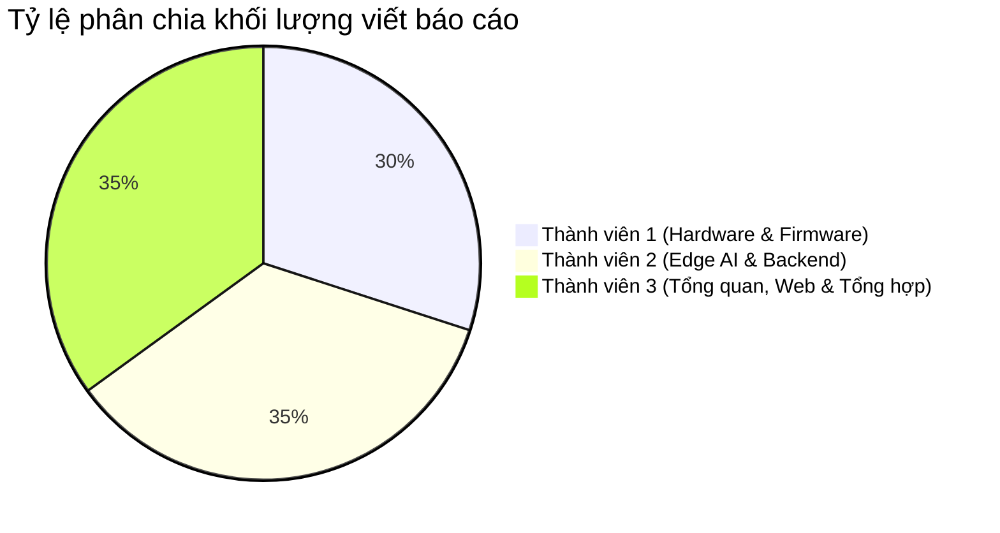

# KẾ HOẠCH PHÂN CHIA VIẾT BÁO CÁO ĐỒ ÁN (HẠN NỘP: 26/11/2026)

**Đề tài:** Hệ thống IoT giám sát và phát hiện xâm nhập trước cửa nhà dựa trên phân tích hành vi bất thường  
**Thời gian làm việc:** Từ 12/11/2026 đến 26/11/2026 (15 ngày)  
**Hình thức:** Báo cáo đồ án học thuật (Word / PDF) theo cấu trúc chuẩn Đại học

---

## I. MỤC LỤC BÁO CÁO CHUẨN & PHÂN CÔNG TÁC GIẢ

Quyển báo cáo dự kiến khoảng **35 - 45 trang** (chưa tính phụ lục code), được chia đều theo chuyên môn của 3 thành viên:

---

### 📘 PHẦN 1: MỞ ĐẦU & TỔNG QUAN HỆ THỐNG
*Phụ trách chính:* **THÀNH VIÊN 3 (Lead / Tổng hợp)** | *Số trang dự kiến:* 6 - 8 trang

* **LỜI CẢM ƠN, LỜI CAM ĐOAN, DANH MỤC TỪ VIẾT TẮT, DANH MỤC HÌNH VẼ & BẢNG BIỂU**
* **CHƯƠNG 1: TỔNG QUAN ĐỀ TÀI**
  - **1.1. Đặt vấn đề & Tính cấp thiết:** Thực trạng an ninh khu vực trước cửa nhà tại các đô thị, hạn chế của camera an ninh thông thường (chỉ ghi hình thụ động, báo động giả nhiều) và chuông cửa truyền thống.
  - **1.2. Mục tiêu nghiên cứu:** Xây dựng hệ thống Hybrid Edge-IoT cảnh báo sớm hành vi lảng vảng bất thường (Loitering) và phát hiện mở/cạy cửa tức thời.
  - **1.3. Đối tượng và phạm vi nghiên cứu:** Giám sát khu vực trước cửa nhà dân dụng, sử dụng Webcam USB và vi điều khiển ESP32.
  - **1.4. Ý nghĩa khoa học và thực tiễn của đề tài.**
* **CHƯƠNG 2: CƠ SỞ LÝ THUYẾT VỀ MẠNG TRUYỀN THÔNG IOT & GIAO THỨC MQTT**
  - **2.1. Tổng quan giao thức MQTT:** Mô hình Publish/Subscribe, Broker Mosquitto, cấu trúc Topics.
  - **2.2. Cơ chế đảm bảo chất lượng dịch vụ (QoS 0, 1, 2) & Retain message trong an ninh.**
  - **2.3. So sánh giao thức MQTT với HTTP/REST:** Tại sao chọn MQTT cho kết nối vi điều khiển.

---

### 📗 PHẦN 2: THIẾT KẾ PHẦN CỨNG & EMBEDDED FIRMWARE
*Phụ trách chính:* **THÀNH VIÊN 1 (Kỹ sư Phần cứng)** | *Số trang dự kiến:* 10 - 12 trang

* **CHƯƠNG 3: THIẾT KẾ PHẦN CỨNG & LẬP TRÌNH FIRMWARE ESP32**
  - **3.1. Phân tích và lựa chọn linh kiện:**
    * Vi điều khiển ESP32 DevKit V1 (38 chân) - thông số kỹ thuật (Dual-core, WiFi/BLE).
    * Cảm biến cửa từ MC-38 (Nguyên lý tiếp điểm Reed switch và nam châm).
    * Cảm biến chuyển động hồng ngoại thụ động PIR HC-SR501.
    * Màn hình hiển thị OLED 0.96 inch SSD1306 (Giao tiếp I2C).
    * Thiết bị chấp hành: Active Buzzer 5V, Module Rơ-le 5V 1 kênh, Nút nhấn khẩn cấp, LED chỉ báo.
  - **3.2. Sơ đồ nguyên lý & Sơ đồ nối dây (Pinout Connection):**
    * Bảng đấu nối chân chi tiết giữa ESP32 và các linh kiện ngoại vi.
    * Sơ đồ nguyên lý mạch (Vẽ bằng Fritzing hoặc Proteus).
  - **3.3. Thiết kế giải thuật Firmware trên ESP32:**
    * Cơ chế ngắt phần cứng (Hardware Interrupt `CHANGE`) trên chân GPIO 14 cho cảm biến MC-38.
    * Lưu đồ thuật toán vòng lặp phi nghẽn (Non-blocking timer) sử dụng hàm `millis()` thay vì `delay()`.
    * Giải thuật chống rung phím (Debounce) cho nút ấn khẩn cấp GPIO 15.
    * Cơ chế kết nối lại tự động khi mất WiFi hoặc mất MQTT Broker.

---

### 📙 PHẦN 3: THỊ GIÁC MÁY TÍNH & XỬ LÝ TRÍ TUỆ NHÂN TẠO TRÊN EDGE SERVER
*Phụ trách chính:* **THÀNH VIÊN 2 (Kỹ sư Edge AI & Vision)** | *Số trang dự kiến:* 12 - 14 trang

* **CHƯƠNG 4: THUẬT TOÁN PHÁT HIỆN HÀNH VI LẢNG VẢNG BẤT THƯỜNG & BACKEND**
  - **4.1. Kiến trúc suy luận tại biên (Edge AI Paradigm):**
    * Lợi thế của việc xử lý AI tại biên (Local Edge) so với Cloud (bảo mật dữ liệu, độ trễ thấp, không phụ thuộc đường truyền Internet quốc tế).
    * Giải pháp thu nhận khung hình tốc độ cao (Threaded Video Capture) bằng OpenCV DirectShow, triệt tiêu độ trễ (Video Lag).
  - **4.2. Mô hình nhận diện người YOLOv8n (Nano):**
    * Kiến trúc mạng YOLOv8 (Backbone, Neck, Head).
    * Lựa chọn phiên bản nano để tối ưu hoá tốc độ suy luận (FPS) trên CPU/GPU máy tính.
  - **4.3. Thuật toán theo dõi đa đối tượng ByteTrack:**
    * Nguyên lý gán Track ID liên tục dựa trên ma trận khoảng cách IoU và bộ lọc Kalman Filter.
    * Khắc phục nhược điểm mất dấu khi đối tượng bị che khuất tạm thời.
  - **4.4. Thuật toán xác định vùng cửa (ROI) & Tính toán Dwell Time:**
    * Thuật toán kiểm tra điểm nằm trong đa giác `cv2.pointPolygonTest`.
    * Lựa chọn điểm neo (Anchor point) tại vị trí tiếp xúc chân người.
    * Công thức tính thời gian lưu trú và điều kiện kích hoạt `STATE_LOITERING` (> 20 giây).
  - **4.5. Dịch vụ phân phối cảnh báo:**
    * Kiến trúc Backend FastAPI và cơ sở dữ liệu SQLite lưu vết sự cố.
    * Tích hợp Telegram Bot API tự động đóng gói ảnh snapshot có đóng dấu timestamp và bounding box gửi về smartphone người dùng.

---

### 📕 PHẦN 4: GIAO DIỆN ĐIỀU KHIỂN, KẾT QUẢ THỰC NGHIỆM & KẾT LUẬN
*Phụ trách chính:* **THÀNH VIÊN 3 (cùng TV1 & TV2 đóng góp số liệu)** | *Số trang dự kiến:* 8 - 10 trang

* **CHƯƠNG 5: HIỆN THỰC HÓA GIAO DIỆN & KẾT QUẢ THỰC NGHIỆM**
  - **5.1. Thiết kế Giao diện Web Dashboard Giám Sát (React 18 + TailwindCSS):**
    * Luồng hiển thị video trực tiếp (MJPEG Stream).
    * Widget hiển thị trạng thái cảm biến (Cửa đóng/mở, chuyển động PIR, trạng thái bảo vệ ARMED).
    * Bảng điều khiển tác vụ nhanh (Arm/Disarm, Mute còi hú).
    * Công cụ hiệu chỉnh vùng cửa trực quan (Interactive ROI Calibration).
    * Bảng nhật ký sự cố (Incident Logs) và modal xem ảnh bằng chứng.
  - **5.2. Kết quả thử nghiệm thực tế theo 4 kịch bản:**
    * Kịch bản 1: Người lảng vảng trước cửa $> 20$ giây.
    * Kịch bản 2: Cạy mở cửa trái phép khi đang kích hoạt báo động.
    * Kịch bản 3: Bấm nút báo động khẩn cấp tại chỗ.
    * Kịch bản 4: Tắt báo động từ xa và cấu hình lại ranh giới ROI.
  - **5.3. Đánh giá hiệu năng hệ thống (Đo đạc thực nghiệm):**
    * Tốc độ xử lý khung hình (FPS) trung bình.
    * Độ trễ phát hiện và thời gian còi kêu khi mở cửa (mili-giây).
    * Thời gian gửi cảnh báo và ảnh chụp qua Telegram Bot (giây).
* **CHƯƠNG 6: KẾT LUẬN VÀ HƯỚNG PHÁT TRIỂN**
  - **6.1. Các kết quả đạt được của đề tài.**
  - **6.2. Hạn chế còn tồn tại.**
  - **6.3. Hướng phát triển trong tương lai** (Nhận diện khuôn mặt người quen/lạ, tích hợp nguồn pin dự phòng UPS, mở rộng cụm cảm biến qua Zigbee/Matter).
* **TÀI LIỆU THAM KHẢO & PHỤ LỤC MÃ NGUỒN CỐT LÕI**

---

## II. TIMELINE CHI TIẾT THEO NGÀY (12/11 → 26/11)

| Giai đoạn | Ngày | Nhiệm vụ cụ thể | Trách nhiệm |
| :--- | :---: | :--- | :--- |
| **Giai đoạn 1:** Viết nháp nội dung | **12/11 - 15/11** | - TV1: Viết xong bản nháp Chương 3 (Linh kiện, sơ đồ nguyên lý, giải thuật ngắt). - TV2: Viết xong bản nháp Chương 4 (YOLOv8n, ByteTrack, công thức ROI, Telegram). - TV3: Viết Chương 1, Chương 2 và tạo khung template Word chuẩn (font, margin, header/footer). | Mỗi thành viên viết phần của mình |
| **Giai đoạn 2:** Chụp ảnh & Thu thập số liệu | **16/11 - 19/11** | - TV1: Chụp ảnh mô hình phần cứng thật sắc nét, xuất sơ đồ Fritzing đưa vào báo cáo. - TV2: Chụp ảnh phát hiện YOLOv8, ảnh snapshot Telegram, bảng đo FPS. - TV3: Chụp ảnh toàn bộ màn hình Dashboard, bảng Incident logs, đo độ trễ mạng LAN. | Cả nhóm phối hợp |
| **Giai đoạn 3:** Ghép nối & Viết kết quả | **20/11 - 22/11** | - Ghép toàn bộ nội dung của TV1, TV2, TV3 vào 1 file Word duy nhất. - Cùng hoàn thiện Chương 5 (Kết quả thực nghiệm) và Chương 6 (Kết luận). - Đánh số thứ tự Hình, Bảng, Phương trình theo từng chương (VD: Hình 3.1, Bảng 4.2). | TV3 chủ trì ghép, TV1 & TV2 hỗ trợ |
| **Giai đoạn 4:** Review chéo & Sửa lỗi | **23/11 - 24/11** | - TV1 đọc dò phần của TV2, TV2 đọc dò phần của TV1 để phát hiện lỗi hành văn, lỗi chính tả. - Kiểm tra lại toàn bộ Danh mục từ viết tắt và Tài liệu tham khảo theo chuẩn IEEE. - Tinh chỉnh dàn trang (không để bảng bị gãy đôi, không để hình trôi xuống trang thừa). | Cả 3 thành viên |
| **Giai đoạn 5:** Đóng gói & Nộp báo cáo | **25/11** | - Xuất file PDF hoàn chỉnh, kiểm tra lại hiển thị trên máy khác. - In ấn, đóng bìa cứng / bìa bóng kính (nếu trường yêu cầu nộp bản giấy). - Cùng nạp file mềm lên hệ thống LMS/Email của trường. | TV3 nộp, TV1 & TV2 xác nhận |
| 🎯 **DEADLINE** | **26/11** | **CHÍNH THỨC NỘP BÁO CÁO ĐỒ ÁN CHO GIẢNG VIÊN HƯỚNG DẪN / BỘ MÔN.** | Toàn nhóm |

---

## III. QUY CHUẨN ĐỊNH DẠNG BÁO CÁO (FORMATTING GUIDELINE)

Để quyển báo cáo chuyên nghiệp và được điểm hình thức cao:
1. **Font chữ & Kích thước:**
   - Font: `Times New Roman` (hoặc font trường quy định).
   - Cỡ chữ: Thân bài `13pt`, Tiêu đề cấp 1 `16pt Bold`, Cấp 2 `14pt Bold`, Cấp 3 `13pt Bold Italic`.
   - Giãn dòng (Line spacing): `1.3 - 1.5 lines`. Before/After: `3pt / 3pt`.
2. **Căn lề trang giấy (Page Margins):**
   - Lề trên: `2.0 cm` | Lề dưới: `2.0 cm`
   - Lề trái (để đóng gáy): `3.0 cm` | Lề phải: `2.0 cm`
3. **Quy tắc hình vẽ & bảng biểu:**
   - Tất cả hình vẽ phải có chú thích đặt **bên dưới hình** (Ví dụ: *Hình 3.2: Sơ đồ nối chân cảm biến MC-38 với ESP32*).
   - Tất cả bảng biểu phải có chú thích đặt **bên trên bảng** (Ví dụ: *Bảng 4.1: So sánh hiệu năng các phiên bản YOLOv8*).
   - Mọi hình và bảng đều phải được trích dẫn (refer) trong đoạn văn bản trước đó.
